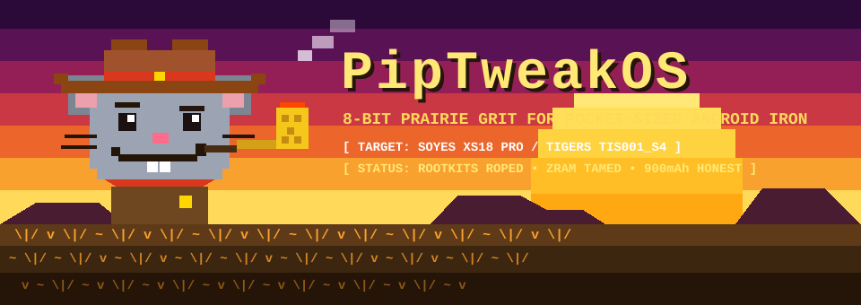

<div align="center">



```text
🟪🟪🟪🟪🟪🟪🟪🟪🟪🟪🟪🟪🟪🟪🟪🟪🟪🟪🟪🟪🟪🟪🟪🟪🟪🟪🟪🟪🟪🟪🟪🟪🟪🟪🟪🟪🟪🟪🟪🟪🟪🟪
🟪🟪🟪   .  *       ___      ___       (  )  (   )  )      *        .    🟪🟪🟪
🟥🟥🟥        .    /   \____/   \     ( )  (    )           .            🟥🟥🟥
🟥🟥🟥     _______|  ==========  |___   ( )                     .        🟥🟥🟥
🟧🟧🟧    /_______    [======]    ___\   ||     ╔══════════════════════╗ 🟧🟧🟧
🟧🟧🟧     ( (•)  |  ^        ^  | (•) ) ||     ║     PipTweakOS       ║ 🟧🟧🟧
🟨🟨🟨      \___/ | (•)      (•) | \___/ 🌽     ║                     ║ 🟨🟨🟨
🟨🟨🟨    ═══╡    |      🐽      |═══════╝      ║                      ║ 🟨🟨🟨
🟧🌅🟧    ═══╡    |  \___🦷🦷__/ |       ☀️     ╚══════════════════════╝ 🟧🌅🟧
🌾🌾🌾 \|/ ~ \|/ ~ \____/🧣\____/ ~ \|/ ~ \|/ ~ \|/ ~ \|/ ~ \|/ ~ \|/ ~ 🌾🌾🌾
🌾🌾🌾 ~ \|/ ~ v ~ \|/ ~ || ~ \|/ ~ v ~ \|/ ~ v ~ \|/ ~ v ~ \|/ ~ v ~ \ 🌾🌾🌾
🟫🟫🟫═══════════════════════════════════════════════════════════════════🟫🟫🟫
```

# 🤠🐭 PipTweakOS


*An open-source custom ROM, rootkit-wrangling, and hardware rehabilitation project that turns malware-ridden pocket clone phones into fast, honest, community-owned hardware.*

</div>

---

## Why PipTweakOS Exists

Our inaugural target device is the **Soyes XS18 Pro (`Tigers TIS001_S4`)**—an ultra-compact 3.0-inch mini smartphone (`MT6580`, `2 GB RAM`, `16 GB eMMC`, `Android 10 / VNDK 29.0`) that ships from the factory with:
- **`SELinux Permissive`** (security walls turned off at the factory),
- An active **Redstone / Adups OTA backdoor (`com.abfota.systemUpdate`)** running as `uid:1000` (`system`),
- A hidden **ODM Spec Spoofing Control Panel (`com.tyd.configdisplay`)** complete with switches for fake "Deca Core" CPUs, fake `6.6"` screens, and fake signal bars,
- A crippling **`1.72 GB` (`90%`) single-stream ZRAM swap** (`zramsize=90%,max_comp_streams=1`) that chokes the quad-core CPU and drains the battery in under an hour, and
- A hardcoded **`3500 mAh` battery lie** on a **`900 mAh` physical cell** (making Android report `25.7%` battery health on day one).

**PipTweakOS** ropes and removes the factory rootkits, tames the ZRAM swap storm, calibrates the true hardware specs, and documents every single step so the next owner can turn a wasted purchase into a great pocket companion.

---

## Baseline Hardware & Forensic Findings (`XS18 Pro` / `TIS001_S4`)

| Component | Stock Reported / Configured | Verified Reality (`ADB` / `/proc` / `dumpsys`) |
| :--- | :--- | :--- |
| **Model / Board ID** | `XS18 Pro` / `Tigers TIS001_S4` | Build `R80K3H1_SYE_C08_XS18Pro_Q_WELCOME_M52_20251126_1836` (`r80h1_sye_c08`) |
| **SoC / Kernel** | MediaTek MT6580 | **32-bit MediaTek MT6580** (`armv7l`, Linux `4.9.188`, 4x Cortex-A7 @ 1.3 GHz) |
| **OS / Treble** | Android 10 (`QP1A.190711.020`, API 29) | **Project Treble (`VNDK 29.0`)**, **System-as-Root**, **Dynamic Partitions (`super`)**, **A-only**, native `q-gsi`/`r-gsi`/`s-gsi` AVB keys |
| **SELinux** | **`Permissive`** | Factory disabled enforcement to allow ODM background services/rootkits |
| **Active Backdoor** | `com.abfota.systemUpdate` (`Rsota.apk`) | **Redstone/Adups FOTA backdoor** running with `uid:1000` (`system`) & `android:persistent="true"` |
| **Spec Spoofer** | `com.tyd.configdisplay` (`ConfigDisplay.apk`) | Hidden `uid:1000` ODM panel controlling `persist.sys.sel*` & `ro.mt_*_switch` |
| **Memory & ZRAM** | **1.92 GB RAM** + **1.72 GB ZRAM** | Real **2 GB LPDDR3**, crippled by `zramsize=90%,max_comp_streams=1` in `/vendor/etc/fstab.mt6580` |
| **Internal Storage** | **16 GB** | **16 GB eMMC** (`system` `679M`, `vendor` `97M`, `product` `613M`, `userdata` `12G` `f2fs`) |
| **Battery** | **3500 mAh** Design / **900 mAh** Full-Charge (`25.7%` health) | True **900 mAh** Li-Po cell (`Charge counter: 900000` uAh); hardcoded `3500 mAh` skews fuel gauge |
| **Display** | **640 x 480** @ `160 ppi`, reported as `5.00"` | Physical **3.0" VGA panel**; hardcoded `160 ppi` causes Android to compute $\frac{800\text{ px}}{160\text{ ppi}} = 5.0"$ |

---

## Documentation & Community Walkthrough

### Core Reference Documentation
- [Exposed: What Was Faked, Why It Was Unsafe & How PipTweakOS Fixes It](docs/EXPOSED-SPOOFING-AND-SECURITY-REPORT.md): Plain-English overview of the security flaws and hardware spoofing discovered on the XS18 Pro.
- [01 — Device Profile (`XS18 Pro / TIS001_S4`)](docs/01-device-profile.md): Complete hardware, kernel, and eMMC partition specifications.
- [02 — Malware, Rootkit, and Security Audit](docs/02-malware-and-audit.md): Forensic analysis of `com.abfota.systemUpdate`, `com.tyd.configdisplay`, `SELinux Permissive`, and ZRAM thrashing.
- [03 — Tools, Third-Party Applications, and Environment](docs/03-tools-and-environment.md): Every on-device and host tool used in the project.

### Step-by-Step Community Walkthrough (`docs/walkthrough/`)
- [Walkthrough Overview & Safety Index](docs/walkthrough/README.md)
- [Stage 1 — Host Setup, Read-Only ADB Audit & Immediate Backdoor Neutralization](docs/walkthrough/01-adb-audit.md)
- [Stage 2 — Full BROM Backup & NVRAM Preservation](docs/walkthrough/02-brom-backup.md)
- [Stage 3 — Bootloader Unlock & `vbmeta` Verification Disabling](docs/walkthrough/03-bootloader-unlock.md)
- [Stage 4 — Kernel Ramdisk (`boot.img`) & `vendor` Sanitization](docs/walkthrough/04-ramdisk-and-vendor-sanitization.md)
- [Stage 5 — Custom ROM / Treble GSI Flashing (`fastbootd`)](docs/walkthrough/05-custom-rom-gsi-flashing.md)
- [Stage 6 — Hardware Overlays, Battery Calibration & Radio Tuning](docs/walkthrough/06-hardware-overlays-and-tuning.md)

## Repository Layout

- `assets/` — 8-bit prairie sunset & cowboy mouse banner art.
- `docs/` — Hardware profiles, security audits, tool inventories, and the stage-by-stage walkthrough.
- `device/soyes/xs18pro/` — Device-specific configurations, patched [fstab.mt6580](device/soyes/xs18pro/rootdir/vendor/etc/fstab.mt6580), and Runtime Resource Overlays (RRO).
- `scripts/` — Reproducible host shell scripts ([01-adb-audit.sh](scripts/01-adb-audit.sh), [01b-adb-neutralize-backdoors.sh](scripts/01b-adb-neutralize-backdoors.sh)).

## License

Licensed under the [Apache License, Version 2.0](LICENSE).
